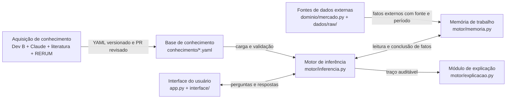

# Arquitetura

## Visão geral

O projeto implementa o modelo conceitual do slide 14 como um sistema
especialista determinístico. A interface coleta respostas, o domínio prepara
fatos calculados e externos, o motor aplica regras versionadas e o módulo de
explicação transforma o traço em uma justificativa legível.

## As 7 caixas no código

| Caixa do slide 14 | Implementação | Responsabilidade |
|---|---|---|
| Interface do usuário | [`app.py`](../app.py) e [`interface/`](../interface/) | Coleta respostas, apresenta o diagnóstico, o diálogo guiado e a base de conhecimento; não decide regras. |
| Base de conhecimento | [`conhecimento/`](../conhecimento/) | Declara perguntas, variáveis, regras e catálogo CONAB em YAML versionado. |
| Motor de inferência | [`motor/inferencia.py`](../motor/inferencia.py) | Avalia premissas, resolve conflitos por camada e prioridade e encadeia conclusões. |
| Memória de trabalho | [`motor/memoria.py`](../motor/memoria.py) | Guarda fatos como valor, confiança, origem e detalhe auditável. |
| Módulo de explicação | [`motor/explicacao.py`](../motor/explicacao.py) | Usa o traço para explicar “como?” e “por quê?”. |
| Aquisição de conhecimento | Equipe/Dev B + Claude; literatura e consulta técnica preparada para a RERUM | Converte literatura e decisões revisadas em regras explícitas; o registro fica em [`docs/regras.md`](./regras.md) e [`docs/processo-ia.md`](./processo-ia.md). |
| Fontes de dados externas | [`dominio/mercado.py`](../dominio/mercado.py) e [`dados/raw/`](../dados/raw/) | Lê snapshots locais da CONAB e insere fatos externos com fonte e período. IBGE permanece previsto para a P3. |

## As 6 ligações

1. **Interface ↔ Motor — perguntas e respostas:** a interface usa as APIs do
   motor, alimenta fatos de usuário e pode receber perguntas opcionais que
   destravam regras quase satisfeitas.
2. **Base → Motor — carga e validação:** `carregar_base()` valida YAML,
   identificadores, variáveis, camadas, operadores e CF antes do uso.
3. **Motor ↔ Memória — leitura e conclusão:** premissas leem fatos; conclusões
   entram com origem `regra`, confiança calculada e o ID da regra.
4. **Motor → Explicação — traço:** cada disparo registra regra, premissas,
   conflito, CF e bloqueios para gerar explicações auditáveis.
5. **Aquisição → Base — gestão do conhecimento:** novas regras entram nos YAML
   versionados e passam por revisão de PR e testes de casos.
6. **Fontes externas → Memória — contexto:** o domínio lê os snapshots locais
   e insere preços CONAB com origem, UF e período antes da inferência.

Os indicadores econômicos de [`dominio/indicadores.py`](../dominio/indicadores.py)
também entram na memória antes do motor, com origem `calculado` e detalhe da
fórmula aplicada.

## Fronteiras e garantias

- A interface não importa YAML nem decide regras.
- `motor/` é genérico e não importa domínio, interface ou Streamlit.
- Não há chamadas de LLM, API de IA ou rede durante a execução.
- A base é validada na inicialização e o motor trabalha em uma cópia da
  memória de entrada.
- A execução é local e os dados externos são snapshots versionados em
  [`dados/raw/`](../dados/raw/).
