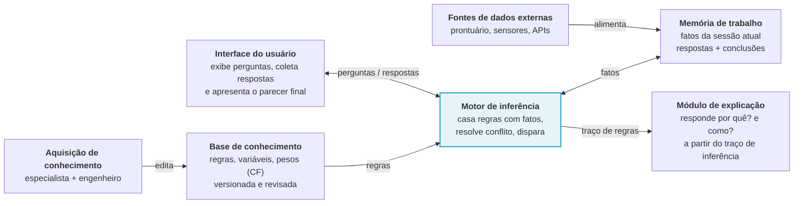

# Processo com IA

Registro de como a IA foi usada no projeto; a apresentação precisa mostrar isso. Regra 9 do `CLAUDE.md`.

## Agentes
Cada dev usa o agente que preferir: Claude Code, Gemini ou GPT. O contexto compartilhado é o `AGENTS.md`; o `CLAUDE.md` só importa esse arquivo, então todos os agentes leem as mesmas regras.

## Nivelamento (diretriz 2)
Cada dev registra o prompt que usou para pedir à IA a explicação de sistema especialista e motor de inferência, e um resumo do que entendeu.

| Dev | Prompt | O que entendi |
|---|---|---|
| A | | |
| B | | |
| C | | |

## Arquitetura

## Diário de decisões
| Data | Pedido à IA | Decisão | O que a IA errou ou a equipe ajustou |
|---|---|---|---|
| 20/10 | Ler os 2 PDFs do hackathon e resumir regras, critérios, entregáveis e o T3 | Escopo: diagnóstico econômico mensal de uma fazenda | O slide 14 foi lido primeiro pelo texto extraído; depois foi conferido como imagem |
| 20/10 | Mapear o modelo conceitual (slide 14) no projeto | 7 componentes e 6 ligações mapeados em pastas e módulos | A 1ª versão deixava a interface ler o YAML direto, sem passar pelo motor; corrigido na revisão |
| 20/10 | Pesquisar bases de dados, só com link verificado | CONAB PrecosMensalUF (recomendada); IBGE PPM e USDA como alternativas | — |
| 20/10 | Sugerir a stack mais simples para 2 dias | Python + Streamlit + motor próprio + regras em YAML + pytest | A equipe confirmou Python |
| 20/10 | Conferir o plano contra as 8 diretrizes do slide 12 | Entraram o nivelamento com a IA e o estudo cruzado do código | — |
| 20/10 | Analisar a base PrecosMensalUF | `base.md`: unidade varia por produto, nomes cortados, mão de obra sem valor, sazonalidade forte do leite | — |
| 20/10 | Criar o esqueleto do repositório | Estrutura do `CLAUDE.md`, dependências com versão fixa, app e testes de fumaça | No teste, o Streamlit subia em todas as interfaces e consultava o IP externo na internet; o `.streamlit/config.toml` agora prende o app ao `localhost` |
| 20/10 | Commitar o esqueleto e criar uma issue por tarefa do plano | 28 issues no GitHub com título `fase-N-<tarefa>`, um milestone por fase e a mesma numeração do plano. A fase seguinte só começa quando todas as issues da atual fecharem | O prefixo de fase no título e a regra de fechar a fase antes de abrir a próxima vieram da equipe |
| 20/10 | Fechar o que faltava da #1 e abrir o PR | O `AGENTS.md` virou a fonte única das regras; o `CLAUDE.md` só tem `@AGENTS.md`, e um teste garante isso | A equipe vai usar Claude, Gemini e GPT, então as regras precisam ser as mesmas para todos os agentes |
| 20/10 | Fazer a #4: fonte externa CONAB | `fatos_mercado(uf, periodo)` devolve um dicionário de fatos `{valor, unidade, fonte, periodo}`: leite (mês e média de 12m), milho, diesel e troca leite:milho (mês e média). Lista fechada por `id_produto` + nível; vazio ou zero não vira fato. Milho e diesel usam o último preço até o mês pedido, com a data dele | O script de download (`baixar_dados.py`) foi removido a pedido da equipe: a base é atualizada e repassada à mão. Ao testar o script, o link da CONAB redirecionava para um endereço com 404 |
| 21/10 | Revisar o `mercado.py` passo a passo e preparar a base para crescer, gerando o YAML e os testes a partir da própria base da CONAB | Catálogo `conhecimento/mercado.yaml` escrito pela equipe (id, nome na CONAB, unidade, faixa); testes gerados a partir do catálogo, um conjunto por produto; script `dados/rascunho_catalogo.py` que imprime um rascunho para a pessoa completar | A ideia inicial era gerar YAML e testes a partir dos dados. A IA mostrou que o teste ficaria circular: com o id 4744 (soja) no lugar do 4742 (milho), só a conferência do nome falha, e a faixa passa. A faixa exata do observado virou uma faixa larga, para não descartar preço novo real |
