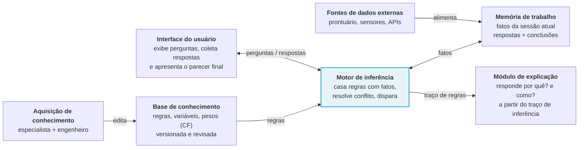

# Guia do sistema especialista

Explicação didática do que é um sistema especialista e de como funciona um motor de inferência, a partir do slide 14 do hackathon e com exemplos do nosso projeto: o diagnóstico econômico da fazenda leiteira. Foi feito com a IA, como pede a diretriz 2 do slide 12 (issue #27).

Leia na ordem: cada seção usa o que a anterior explicou.

O motor ainda está sendo construído. Onde o guia fala de como ele funciona, descreve o desenho combinado no `AGENTS.md` e na issue #2 (contratos).

## Sumário
1. O que é um sistema especialista
2. Os 7 componentes (slide 14)
3. Fatos e regras: a linguagem do sistema
4. Como o motor pensa: o ciclo de inferência
5. Resolução de conflito
6. Fator de certeza (CF)
7. Explicação: "como?" e "por quê?"
8. Exemplo completo: do formulário ao parecer
9. Glossário

## 1. O que é um sistema especialista

### A ideia em uma frase
Um sistema especialista é um programa que resolve problemas de uma área específica **imitando o raciocínio de um especialista humano**, a partir de regras escritas de forma explícita.

### Uma analogia: o técnico que visita a fazenda
Pense num técnico de assistência técnica que visita uma fazenda de leite para avaliar se ela dá lucro:
1. **Ele pergunta** quantas vacas estão em lactação, quantos litros a fazenda produziu no mês, quanto o laticínio pagou e quanto se gastou com ração, mão de obra e energia.
2. **Ele anota** as respostas na prancheta e faz algumas contas, como o custo por litro.
3. **Ele compara** os números com o que sabe: "se a receita paga os gastos do mês, mas não cobre a depreciação, a fazenda só se mantém no curto prazo".
4. **Ele conclui** qual é a situação da fazenda, as causas prováveis e o que fazer.
5. **Ele explica** ao produtor por que chegou àquela conclusão, se o produtor perguntar.

Um sistema especialista faz o mesmo, e cada passo vira uma peça do sistema:

| O técnico... | No sistema especialista | Onde fica no projeto |
|---|---|---|
| faz perguntas e entrega o parecer | interface do usuário | `app.py` e `interface/` |
| conhece as regras do ofício | base de conhecimento | `conhecimento/regras.yaml` |
| anota os dados na prancheta | memória de trabalho | `motor/memoria.py` |
| raciocina, comparando dados com regras | motor de inferência | `motor/inferencia.py` |
| explica por que concluiu | módulo de explicação | `motor/explicacao.py` |

A seção 2 detalha essas peças e mais duas que aparecem no slide 14.

### O que muda em relação a um programa comum
Num programa comum, o conhecimento fica **misturado ao código**. A regra do técnico viraria um `if`:

```python
if receita_total >= coe and receita_total < cot:
    situacao_economica = "curto_prazo"
```

Num sistema especialista, a mesma regra fica **fora do código**, na base de conhecimento. Este é o exemplo do `AGENTS.md`:

```yaml
- id: R-SIT-03
  descricao: Receita cobre o COE mas não o COT; sobrevive só no curto prazo
  camada: situacao
  prioridade: 50
  se:
    - [receita_total, ">=", $coe]
    - [receita_total, "<", $cot]
  entao: {fato: situacao_economica, valor: curto_prazo}
  cf: 1.0
  fonte: "Matsunaga et al. (1976), metodologia de custo operacional"
```

O COE (custo operacional efetivo) é o que sai do caixa no mês. O COT (custo operacional total) soma a ele custos que não saem do caixa, como a depreciação. As definições completas ficam com os indicadores.

A lógica é a mesma, mas a forma muda tudo:

| | Programa comum | Sistema especialista |
|---|---|---|
| Onde fica o conhecimento | espalhado pelo código | numa base separada, uma regra por vez |
| Quem muda uma regra | um programador, mexendo no código | quem entende do assunto, editando o YAML; o motor não muda |
| De onde veio a regra | não se sabe | cada regra tem `fonte` (aqui, Matsunaga et al., 1976) |
| Explica a resposta | não | sim: diz qual regra disparou e com quais valores |
| Lida com incerteza | não | sim: cada conclusão tem um grau de confiança, o `cf` |

Isso só funciona porque o **motor de inferência é genérico**: ele não sabe nada de leite nem de economia, só sabe aplicar regras a fatos. Por isso o `AGENTS.md` proíbe que `motor/` importe `dominio/`. Com outra base de conhecimento, o mesmo motor diagnosticaria outra coisa.

### Um pouco de história
A ideia é dos anos 1970. O exemplo clássico é o MYCIN, criado na Universidade Stanford para ajudar médicos a identificar a bactéria de infecções graves e escolher o antibiótico. Ele tinha algumas centenas de regras no formato SE ... ENTÃO ..., respondia "por quê?" e "como?" e usava fatores de certeza: o nosso CF (seção 6) segue o modelo dele. Depois, tiraram as regras médicas e reaproveitaram o motor vazio, chamado EMYCIN, em outras áreas. É a mesma separação entre base e motor descrita acima.

### Por que a LLM não é o sistema especialista
A regra do hackathon é clara: nenhuma chamada a LLM ou a API de IA no código da aplicação. Quem decide é a base de conhecimento com o motor de inferência. O motivo aparece quando se comparam os dois:

| | LLM (ChatGPT, Claude, Gemini) | Sistema especialista |
|---|---|---|
| Como chega à resposta | gera texto a partir de padrões aprendidos | aplica regras escritas, uma a uma |
| Mesma pergunta, mesma resposta? | nem sempre | sempre: é determinístico |
| Dá para auditar? | não dá para apontar a "regra" que gerou a resposta | dá: cada conclusão aponta a regra, os valores e a fonte |
| Pode inventar? | pode, e com confiança | só conclui o que as regras permitem |
| Precisa de internet? | em geral, sim | não: roda 100% em localhost |

A IA entra no **desenvolvimento**: ajuda a escrever código, analisar dados e documentar, e tudo fica registrado no `docs/processo-ia.md`. Na hora de usar o sistema, quem raciocina é o motor.

### Por que faz sentido para o T3
O diagnóstico econômico de uma fazenda segue uma metodologia conhecida, com contas (custo por litro, margens) e critérios ("a receita cobre o COT?"). Isso cabe bem em regras. Além disso, o produtor ou o técnico precisa **confiar** no parecer, então ver o porquê de cada conclusão vale tanto quanto a própria conclusão.

### Em resumo
- Sistema especialista = **base de conhecimento** (regras explícitas) + **motor de inferência** (raciocínio genérico).
- O conhecimento fica fora do código, com fonte e grau de confiança.
- O sistema explica o que concluiu e sempre chega à mesma resposta.
- A LLM ajuda a construir o sistema, mas não decide nada nele.

## 2. Os 7 componentes (slide 14)
O slide 14 mostra o modelo conceitual de um sistema especialista: 7 peças e 6 ligações. O motor de inferência, em destaque, fica no centro, porque é a única peça que raciocina. As outras guardam conhecimento, guardam dados, conversam com o usuário ou explicam.



### As 7 peças, uma a uma
A ordem abaixo segue o caminho do conhecimento: de onde ele vem, onde fica, quem o usa e como a resposta chega ao usuário.

| Peça | O que é | Onde fica no projeto |
|---|---|---|
| Aquisição de conhecimento | o trabalho de tirar o conhecimento de quem sabe e escrever em regras | revisão de PRs em `conhecimento/` |
| Base de conhecimento | as regras, as perguntas e os produtos de mercado | `conhecimento/*.yaml` |
| Memória de trabalho | os fatos do caso que está sendo analisado | `motor/memoria.py` |
| Motor de inferência | o raciocínio: aplica as regras aos fatos | `motor/inferencia.py` |
| Módulo de explicação | responde "como?" e "por quê?" | `motor/explicacao.py` |
| Interface do usuário | faz as perguntas e mostra o parecer | `app.py` e `interface/` |
| Fontes de dados externas | dados que vêm de fora, sem perguntar ao usuário | `dados/raw/` e `dominio/mercado.py` |

#### Aquisição de conhecimento: especialista + engenheiro
O conhecimento nasce com um **especialista**, alguém que entende do assunto: um zootecnista, um técnico de campo ou a literatura de economia leiteira. Quem o transforma em regras é o **engenheiro do conhecimento**, papel que no hackathon é da equipe. É o passo mais difícil de um sistema especialista, porque o especialista sabe fazer, mas nem sempre sabe dizer como faz.

No projeto, isso aparece em três hábitos:
- toda regra tem `fonte`, de onde o conhecimento veio;
- um limite sem fonte confiável recebe `fonte: "PENDENTE"` e é apontado, em vez de inventado;
- todo PR que mexe em `conhecimento/` é revisado por outra pessoa.

#### Base de conhecimento: o que o sistema sabe
É o "livro de regras" do sistema, escrito em YAML para que qualquer pessoa da equipe leia e revise. Ela é **versionada** (fica no git, com histórico) e **revisada** (mudança só por PR). No projeto, são três arquivos:
- `conhecimento/regras.yaml`: as regras de produção, no formato SE ... ENTÃO ... (seção 3);
- `conhecimento/perguntas.yaml`: o que perguntar ao usuário, com unidade, faixa válida e texto de ajuda;
- `conhecimento/mercado.yaml`: quais produtos da CONAB viram fatos e como lê-los.

As regras são organizadas em **camadas**, do dado à ação: **indicador** → **situação** → **causa** → **recomendação**. Uma regra de situação, por exemplo, usa indicadores para concluir se a fazenda está no prejuízo ou no lucro.

#### Memória de trabalho: a prancheta do caso
Guarda os **fatos** do caso que está sendo analisado: uma fazenda, um mês. Ela começa vazia a cada diagnóstico e vai sendo preenchida. Cada fato tem **valor**, **CF** (grau de confiança, seção 6) e **origem**, que diz de onde ele veio:

| Fato | Valor | Origem |
|---|---|---|
| `vacas_lactacao` | 40 | usuário: respondeu no formulário |
| `producao_litros` | 24.000 L | usuário |
| `preco_leite_fazenda` | R$ 2,90/L | usuário |
| `receita_total` | R$ 69.600 | calculado: 24.000 L × R$ 2,90 |
| `coe` | R$ 62.000 | calculado a partir dos custos informados |
| `cot` | R$ 74.000 | calculado |
| `preco_leite_uf` | R$ 3,04/L (MG, 09/2026) | externo: CONAB |
| `situacao_economica` | `curto_prazo` | concluído pela regra R-SIT-03 |

A fazenda é ilustrativa: só o preço da CONAB é real. Os nomes `producao_litros` e `preco_leite_fazenda` também são ilustrativos, porque a lista oficial de variáveis sai da issue #3.

Uma regra do projeto vale aqui: **campo opcional vazio não vira zero**. Se o usuário não informou um dado, o fato simplesmente não entra na memória, e as regras que dependem dele não disparam. Um zero inventado levaria a conclusões erradas.

#### Motor de inferência: quem raciocina
É o centro do diagrama. Ele olha as regras da base e os fatos da memória e pergunta, repetidamente: "que regras têm todas as condições verdadeiras agora?". Escolhe uma, **dispara** e grava a conclusão na memória como fato novo. Esse fato pode destravar outras regras, e o ciclo continua até não sobrar nada a disparar. É **genérico**: não sabe nada de leite. O ciclo é o assunto das seções 4 e 5.

#### Módulo de explicação: o porquê de cada resposta
Cada vez que uma regra dispara, o motor anota num **traço**: qual regra, com quais fatos e valores, e com que CF. O módulo de explicação lê esse traço e responde duas perguntas:
- **"Como?"**: como o sistema chegou a esta conclusão? ("porque a receita, R$ 69.600, cobre o COE, R$ 62.000, mas não o COT, R$ 74.000: regra R-SIT-03");
- **"Por quê?"**: por que o sistema está me perguntando isto? ("porque a regra X precisa desse dado para decidir").

Detalhes na seção 7.

#### Interface do usuário: a conversa
No projeto é uma página Streamlit. Ela faz as perguntas do `perguntas.yaml`, valida as respostas (unidade, faixa) e mostra o parecer: indicadores, situação, causas, recomendações, cada uma com o seu CF, e os botões de "como?" e "por quê?". A interface **não decide nada**: só conversa com o motor. A primeira versão do mapeamento do projeto deixava a interface ler o YAML direto, e isso foi corrigido justamente para não furar esse desenho.

#### Fontes de dados externas: o que vem de fora
O slide cita exemplos genéricos (prontuário, sensores, APIs). No nosso caso, são os preços mensais por UF da CONAB: leite pago ao produtor, milho e diesel. O arquivo fica em `dados/raw/`, sem edição, e o `dominio/mercado.py` o transforma em fatos como `preco_leite_uf`, sempre com fonte e período. Como a demo roda sem internet, a fonte é um arquivo baixado antes, e não uma API.

### As 6 ligações (as setas)

| Seta | O que passa | Como fica no projeto |
|---|---|---|
| Aquisição → Base: **edita** | regras novas ou corrigidas | PR em `conhecimento/`, revisado por outra pessoa |
| Base → Motor: **regras** | as regras de produção | `motor/regras.py` carrega e valida: toda variável citada existe e todo CF fica entre 0 e 1 |
| Motor ↔ Memória: **fatos** | nos dois sentidos: o motor lê fatos para casar regras e grava as conclusões | cada conclusão entra com valor, CF e origem |
| Fontes externas → Memória: **alimenta** | dados de fora, antes de o raciocínio começar | fatos da CONAB, com fonte e período |
| Interface ↔ Motor: **perguntas / respostas** | o motor diz o que falta saber; a interface pergunta e devolve as respostas | as respostas entram como fatos de origem usuário |
| Motor → Explicação: **traço de regras** | o registro de cada disparo | base do "como?" e do "por quê?" |

Uma peça do projeto não aparece no slide: o `dominio/diagnostico.py`. Ele é o maestro de cada diagnóstico: recebe as respostas, calcula os indicadores (`dominio/indicadores.py`), busca os fatos de mercado, chama o motor e devolve o resultado para a interface.

### Uma rodada completa
1. A interface faz as perguntas e o produtor responde.
2. As respostas entram na memória (origem usuário), os indicadores são calculados (origem calculado) e os preços da CONAB chegam (origem externo).
3. O motor carrega as regras da base.
4. O motor casa regras com fatos, escolhe uma e dispara. A conclusão vira fato novo, e o disparo vai para o traço.
5. O passo 4 se repete até nenhuma regra nova poder disparar.
6. A interface mostra o parecer, e o módulo de explicação responde "como?" e "por quê?" a partir do traço.

A seção 8 percorre essa rodada com a fazenda de exemplo, conta por conta.

### Em resumo
- São 7 peças, e só o motor raciocina: a base guarda o conhecimento, a memória guarda os fatos do caso e a explicação lê o traço.
- Todo fato tem valor, CF e origem: usuário, calculado, externo ou concluído por uma regra.
- Dado ausente não vira zero: o fato não entra e as regras que dependem dele não disparam.
- A interface só conversa. Quem decide é o motor, com as regras da base.

## 3. Fatos e regras: a linguagem do sistema
Todo o raciocínio do sistema usa só duas coisas: **fatos**, o que se sabe sobre o caso, e **regras**, o que fazer com o que se sabe.

### O fato
Um fato é uma afirmação sobre o caso analisado, com quatro partes:

| Parte | O que é | Exemplo |
|---|---|---|
| nome | identificador em `snake_case`, sem acento | `preco_leite_uf` |
| valor | um número com unidade ou uma categoria | `3.04` (R$/L) ou `curto_prazo` |
| CF | grau de confiança, de 0 a 1 (seção 6) | `1.0` |
| origem | de onde o fato veio | `externo`: CONAB, MG, 09/2026 |

Três cuidados com fatos:
- **Toda variável tem unidade declarada** (no `perguntas.yaml`, no `mercado.yaml` ou no indicador). Dinheiro em R$, volume em litros e período de referência de 1 mês. Assim, ninguém compara R$/L com R$/kg por engano.
- **Um fato pode ter vários valores.** Uma fazenda pode ter mais de uma causa provável para o mesmo problema, e todas ficam guardadas no mesmo fato.
- **Fato desconhecido não existe.** Ele não vale zero nem "vazio": simplesmente não está na memória (seção 2).

### A regra
Uma regra diz: **SE** estas condições forem verdadeiras, **ENTÃO** conclua isto. A R-SIT-03, lida em português:

> SE a receita total for maior ou igual ao COE **E** a receita total for menor que o COT, ENTÃO a situação econômica é `curto_prazo`, com confiança 1,0.

E em YAML, campo a campo:

| Campo | Para que serve | Na R-SIT-03 |
|---|---|---|
| `id` | identificador único; aparece no traço e na explicação | `R-SIT-03` |
| `descricao` | o que a regra diz, em português claro | "Receita cobre o COE mas não o COT; sobrevive só no curto prazo" |
| `camada` | em que etapa do raciocínio a regra atua | `situacao` |
| `prioridade` | quem dispara antes quando há conflito (seção 5) | `50` |
| `se` | as condições, chamadas de **premissas** | duas comparações |
| `entao` | a conclusão: qual fato recebe qual valor | `situacao_economica = curto_prazo` |
| `cf` | quanto se confia na regra, de 0 a 1 (seção 6) | `1.0` |
| `fonte` | de onde veio o conhecimento | Matsunaga et al. (1976) |

Além disso, toda regra precisa de pelo menos um caso de teste que a faça disparar. Sem teste, ninguém garante que ela funciona.

### As premissas: `[fato, operador, valor]`
Cada premissa compara um fato com um valor:

| Operador | Significa | Exemplo |
|---|---|---|
| `==` | é igual a | `[situacao_economica, "==", curto_prazo]` |
| `!=` | é diferente de | `[situacao_economica, "!=", prejuizo]` |
| `<` `<=` `>` `>=` | menor, menor ou igual, maior, maior ou igual | `[receita_total, ">=", $coe]` |
| `in` | o valor do fato está numa lista | `[uf, "in", [MG, SP, PR]]` |

O detalhe que mais confunde é o **`$`**:
- **`$coe`** quer dizer "o valor do fato `coe`", seja ele qual for nesta fazenda;
- **`curto_prazo`**, sem `$`, é o próprio texto "curto_prazo", um valor literal.

Quando o fato tem vários valores, `==` é verdadeiro se **algum** deles bater. Se as causas forem `preco_baixo` e `custo_alimentar_alto`, a premissa `[causa, "==", preco_baixo]` é verdadeira.

Uma premissa **não faz contas**. Não existe `[receita_total, ">", 1.05 × $coe]`. Toda conta vira um **indicador**, calculado antes do raciocínio (`dominio/indicadores.py`), e a regra só compara o resultado. Assim cada fórmula fica num lugar só e aparece no "como?".

### E e OU
- Dentro de uma regra, as premissas valem com **E**: todas precisam ser verdadeiras.
- Para **OU**, escreva outra regra com a mesma conclusão. Se as duas dispararem, o sistema fica mais confiante na conclusão, e a seção 6 mostra como os CFs se combinam.

### Regras em cadeia: as camadas
As regras são organizadas do dado à ação: **indicador** → **situação** → **causa** → **recomendação**. A conclusão de uma regra vira um fato novo, que serve de premissa para a próxima. É assim que o sistema vai de números soltos até um conselho.

As três regras abaixo são **ilustrativas**: mostram a cadeia, mas o conteúdo real das regras sai das issues #8 e #12. Por isso elas têm `fonte: "PENDENTE"`, e os CFs também são de exemplo.

```yaml
- id: R-IND-01
  descricao: Preço recebido pela fazenda abaixo do preço da UF no mesmo mês
  camada: indicador
  prioridade: 50
  se:
    - [preco_leite_fazenda, "<", $preco_leite_uf]
  entao: {fato: preco_leite, valor: abaixo_mercado}
  cf: 1.0
  fonte: "PENDENTE"

- id: R-CAU-01
  descricao: No curto prazo e com preço abaixo do mercado, o preço recebido é causa provável
  camada: causa
  prioridade: 50
  se:
    - [situacao_economica, "==", curto_prazo]
    - [preco_leite, "==", abaixo_mercado]
  entao: {fato: causa, valor: preco_recebido_baixo}
  cf: 0.7
  fonte: "PENDENTE"

- id: R-REC-01
  descricao: Preço recebido baixo; negociar com o laticínio
  camada: recomendacao
  prioridade: 50
  se:
    - [causa, "==", preco_recebido_baixo]
  entao: {fato: recomendacao, valor: negociar_com_laticinio}
  cf: 0.8
  fonte: "PENDENTE"
```

Na fazenda de exemplo, a cadeia fica assim:

```
preco_leite_fazenda = 2,90  e  preco_leite_uf = 3,04
        │  R-IND-01
        ▼
preco_leite = abaixo_mercado      receita, COE e COT
        │                                │  R-SIT-03
        │                                ▼
        │                     situacao_economica = curto_prazo
        └───────────────┬────────────────┘
                        │  R-CAU-01
                        ▼
              causa = preco_recebido_baixo
                        │  R-REC-01
                        ▼
        recomendacao = negociar_com_laticinio
```

Repare que nenhuma regra conhece as outras. A R-CAU-01 não sabe que a R-SIT-03 existe: só precisa que o fato `situacao_economica` esteja na memória. Quem encadeia é o motor, e esse é o assunto da seção 4.

### Em resumo
- Fato = nome + valor + CF + origem. Fato desconhecido não entra na memória.
- Regra = SE premissas (todas com E) ENTÃO conclusão, com `id`, `descricao`, `camada`, `prioridade`, `cf` e `fonte`.
- `$nome` é o valor de outro fato; sem `$`, o valor é literal. Premissa não faz conta: conta vira indicador.
- As camadas levam do número ao conselho, e a conclusão de uma regra vira premissa da seguinte.

## 4. Como o motor pensa: o ciclo de inferência
O motor repete sempre o mesmo ciclo de três passos, até não ter mais o que fazer:

1. **Casar:** para cada regra que ainda não disparou, ele confere se **todas** as premissas são verdadeiras com os fatos da memória. As regras que passam formam o **conjunto de conflito**: as candidatas a disparar agora.
2. **Resolver o conflito:** se houver mais de uma candidata, ele escolhe **uma** (seção 5).
3. **Disparar:** ele grava a conclusão da regra escolhida na memória, como fato novo, e anota o disparo no traço.

Depois volta ao passo 1. O fato novo pode completar as premissas de outra regra, que vira candidata no ciclo seguinte. Quando o conjunto de conflito fica **vazio**, o motor para: nada mais pode ser concluído.

### O ciclo na fazenda de exemplo
A memória começa com os fatos do usuário, os calculados e os da CONAB (seção 2). A base tem as 4 regras da seção 3:

| Ciclo | Conjunto de conflito | Escolhida | Fato novo na memória |
|---|---|---|---|
| 1 | R-SIT-03 e R-IND-01 | R-SIT-03: mesma prioridade, mas tem mais condições (seção 5) | `situacao_economica = curto_prazo` |
| 2 | R-IND-01 | R-IND-01 | `preco_leite = abaixo_mercado` |
| 3 | R-CAU-01 | R-CAU-01 | `causa = preco_recebido_baixo` |
| 4 | R-REC-01 | R-REC-01 | `recomendacao = negociar_com_laticinio` |
| 5 | vazio | — | o motor para |

O que aconteceu em cada ciclo:
- **Ciclo 1.** A R-SIT-03 casa: R$ 69.600 ≥ R$ 62.000 e R$ 69.600 < R$ 74.000. A R-IND-01 também: R$ 2,90 < R$ 3,04. A R-CAU-01 ainda não casa, porque `situacao_economica` e `preco_leite` não estão na memória. A R-REC-01 também não, porque não há `causa`.
- **Ciclo 2.** A R-SIT-03 já disparou e sai da disputa. A R-CAU-01 tem uma premissa verdadeira (`curto_prazo`), mas falta a outra, então só a R-IND-01 é candidata.
- **Ciclos 3 e 4.** Cada disparo destrava a regra seguinte da cadeia.
- **Ciclo 5.** As 4 regras já dispararam e o conjunto fica vazio: fim.

O CF de cada fato novo é calculado no disparo; as contas estão na seção 6.

### Duas regras que fazem o ciclo funcionar
- **Cada regra dispara no máximo uma vez.** Sem isso, a R-SIT-03 seria candidata em todos os ciclos, porque as premissas dela continuam verdadeiras, e o motor nunca pararia. Com isso, o ciclo termina depois de, no máximo, um disparo por regra.
- **Premissa sobre fato desconhecido é falsa.** Se o produtor não informar o preço que recebe, a R-IND-01 nunca casa. Sem ela, a R-CAU-01 e a R-REC-01 também não disparam. A cadeia para onde o dado acaba, sem erro e sem inventar nada, e a R-SIT-03 continua funcionando normalmente. (Premissa com CF abaixo de 0,2 também conta como falsa; seção 6.)

### O laço, em código
Um esboço em Python para enxergar o ciclo. Não é o código do motor, que ainda vai ser escrito na issue #5:

```python
disparadas = set()
while True:
    conjunto = [
        regra
        for regra in regras
        if regra.id not in disparadas and premissas_verdadeiras(regra, memoria)
    ]
    if not conjunto:
        break  # nada mais pode ser concluído
    regra = resolver_conflito(conjunto)  # seção 5
    memoria.adicionar(
        regra.conclusao, cf=calcular_cf(regra, memoria), origem=regra.id
    )  # seção 6
    traco.append(registro_do_disparo(regra, memoria))  # seção 7
    disparadas.add(regra.id)
```

### Encadeamento progressivo × regressivo
O nosso motor faz **encadeamento progressivo**: parte dos fatos e avança até as conclusões. Existe o caminho inverso, o **encadeamento regressivo**, que o MYCIN usava:

| | Progressivo (o nosso) | Regressivo |
|---|---|---|
| Começa por | os fatos | uma hipótese a provar |
| Pergunta que faz | "o que posso concluir com o que já sei?" | "o que preciso saber para provar isto?" |
| Quando é bom | quando os dados vêm todos de uma vez, como no nosso formulário | quando cada pergunta custa caro e se quer perguntar só o necessário |

O projeto empresta uma ideia do regressivo na issue #26 (diálogo guiado pelo motor, prioridade P2). Depois da primeira rodada, o motor olharia as regras que quase dispararam e perguntaria ao usuário só o que falta para destravá-las.

### Em resumo
- O ciclo é: **casar** → **resolver o conflito** → **disparar** → repetir, até o conjunto de conflito ficar vazio.
- Cada disparo grava um fato novo, que pode destravar outras regras: é assim que as cadeias acontecem.
- Cada regra dispara uma vez só, e premissa sobre fato desconhecido é falsa. Por isso o motor sempre termina e nunca inventa dado.
- O nosso encadeamento é progressivo: dos fatos para as conclusões.

## 5. Resolução de conflito
Quando mais de uma regra está pronta para disparar no mesmo ciclo, o motor precisa escolher **uma**. A escolha segue três critérios, nesta ordem:

1. **Maior `prioridade`** ganha.
2. Se empatar, ganha a regra com **mais condições** (a mais específica).
3. Se ainda empatar, ganha a que aparece **primeiro no arquivo**.

O terceiro critério garante que sempre sai exatamente uma regra. Por isso o resultado é **determinístico**: os mesmos dados, com a mesma base, dão sempre o mesmo parecer, e é isso que permite auditar o sistema.

### Na fazenda de exemplo
No ciclo 1 da seção 4, a R-SIT-03 e a R-IND-01 estavam prontas:

| Critério | R-SIT-03 | R-IND-01 | Resultado |
|---|---|---|---|
| 1. prioridade | 50 | 50 | empate |
| 2. condições | 2 | 1 | **R-SIT-03 ganha** |

A perdedora **não é descartada**: ela continua candidata e dispara no ciclo seguinte, como a R-IND-01 fez no ciclo 2. Aqui a ordem mudou só o caminho, não o resultado: as duas conclusões acabaram na memória.

### Quando a ordem muda o resultado
A ordem importa de verdade quando duas regras concluem **valores diferentes para um fato que só admite um valor**. A situação econômica, por exemplo, não pode ser `curto_prazo` e `lucro` ao mesmo tempo. Nesse caso, a primeira regra a disparar define o valor, e a outra fica **bloqueada**. O contrato da issue #2 prevê variáveis marcadas como `unico` para isso, e prevê que o traço registre as regras bloqueadas.

O exemplo clássico, fora do nosso domínio, mostra por que a regra mais específica deve ganhar:

```yaml
- id: AVE-VOA
  se:
    - [animal, "==", ave]
  entao: {fato: voa, valor: sim}

- id: PINGUIM-NAO-VOA
  se:
    - [animal, "==", ave]
    - [especie, "==", pinguim]
  entao: {fato: voa, valor: nao}
```

Para um pinguim, as duas regras casam e têm a mesma prioridade. A PINGUIM-NAO-VOA tem mais condições, então ganha: `voa = nao`. A AVE-VOA fica bloqueada, porque `voa` já tem valor. Sem o critério das condições, quem decidiria seria a ordem no arquivo, e bastaria alguém reordenar o YAML para o pinguim voltar a voar.

A ideia geral: **a regra com mais condições descreve um caso mais particular**, e o caso particular costuma ser a exceção que deve valer sobre a regra geral.

### Para quem escreve regras
- **Prefira condições que não se sobrepõem.** As faixas da situação econômica, por exemplo (receita abaixo do COE, entre o COE e o COT e assim por diante), não se cruzam. Assim, nunca há conflito.
- **Para escrever uma exceção, acrescente a condição que a diferencia.** O critério das condições faz a exceção ganhar sem mexer em prioridade.
- **Use `prioridade` só quando precisar**, e diga o porquê na `descricao`. As camadas já ordenam boa parte do raciocínio sozinhas: uma regra de causa não dispara antes de existir a situação de que ela depende.
- **Teste o conflito.** Se duas regras podem casar juntas, crie um caso de teste em que isso aconteça e confira quem ganhou.

### Em resumo
- Mais de uma regra pronta? Ganha a de **maior prioridade**, depois a de **mais condições**, depois a que vem **primeiro no arquivo**.
- A perdedora continua candidata nos ciclos seguintes, a não ser que conclua outro valor para um fato de valor único: aí fica bloqueada.
- Os critérios tornam o motor determinístico, e o traço mostra quem disputou e quem ganhou.

## 6. Fator de certeza (CF)
Nem todo conhecimento é certeza. "Receita abaixo do COT significa que a fazenda não cobre a depreciação" é conta, mas "o preço baixo é a causa provável" é julgamento de especialista. O **fator de certeza** (CF) mede o grau de confiança em cada fato e em cada regra, de **0** (nenhuma) a **1** (certeza total).

O CF vem do MYCIN (seção 1). Lá ele ia de −1 a 1, para expressar também descrença; aqui usamos só de 0 a 1.

### De onde vêm os números
| O quê | CF | De onde vem |
|---|---|---|
| Resposta do usuário | 1,0 | o produtor informou; a issue #16 (P2) pode deixar o usuário dizer que não tem certeza |
| Indicador calculado de dados certos | 1,0 | é conta |
| Fato da CONAB | a definir | ficou como pendência registrada na issue #4 |
| Regra | o campo `cf` | quanto o especialista confia na regra: 1,0 para conta ou metodologia, como a R-SIT-03; menos para julgamento, como uma causa "provável" |

O `cf` de uma regra é conhecimento como qualquer outro: precisa de fonte. Se não houver, o número é um palpite e deve ficar marcado como `PENDENTE` até alguém revisar.

### Conta 1: o CF de uma conclusão
```
CF da conclusão = cf da regra × menor CF entre as premissas
```
- **Por que o menor:** as premissas valem com E, e uma corrente é tão forte quanto o seu elo mais fraco.
- **Por que multiplicar:** mesmo com premissas certas, a regra só merece a confiança que tem.
- O CF de uma premissa é o CF do fato que ela testa. Quando ela compara dois fatos (com `$`), vale o menor dos dois. Esse detalhe é para a issue #5 confirmar.

Na fazenda de exemplo, com todos os fatos de entrada em 1,0:

| Regra | cf da regra | Menor CF das premissas | CF da conclusão |
|---|---|---|---|
| R-SIT-03 | 1,0 | 1,0 | `situacao_economica = curto_prazo`: 1,0 × 1,0 = **1,0** |
| R-IND-01 | 1,0 | 1,0 | `preco_leite = abaixo_mercado`: **1,0** |
| R-CAU-01 | 0,7 | min(1,0; 1,0) = 1,0 | `causa = preco_recebido_baixo`: 0,7 × 1,0 = **0,7** |
| R-REC-01 | 0,8 | 0,7 (a causa) | `recomendacao = negociar_com_laticinio`: 0,8 × 0,7 = **0,56** |

A confiança **cai ao longo da cadeia**, e faz sentido: quanto mais longe do dado, mais julgamento entra e menos certeza sobra. A situação econômica é conta (100%), a causa é provável (70%) e a recomendação depende da causa (56%).

### Conta 2: o limite de 0,2
```
premissa com CF menor que 0,2 conta como falsa
```
Sem esse limite, conclusões cada vez mais fracas continuariam disparando regras e encheriam o parecer de ruído. O MYCIN usava o mesmo valor.

Suponha que o produtor não tenha certeza do preço que recebe, e esse dado entre com CF 0,6 ou 0,25 (o que a issue #16 permitiria):

| Regra | Preço da fazenda com CF 0,6 | Preço da fazenda com CF 0,25 |
|---|---|---|
| R-IND-01 | 1,0 × 0,6 = **0,6** | 1,0 × 0,25 = **0,25** |
| R-CAU-01 | 0,7 × min(1,0; 0,6) = **0,42** | 0,7 × min(1,0; 0,25) = **0,175** |
| R-REC-01 | 0,8 × 0,42 = **0,336** | premissa com 0,175 < 0,2: **não dispara** |

Com CF 0,25, a cadeia vai até a causa (17,5%), mas a recomendação não sai. O sistema não recomenda nada com base numa causa tão incerta.

### Conta 3: duas regras, mesma conclusão
```
CF combinado = CF1 + CF2 × (1 − CF1)
```
É o caso do OU da seção 3: duas regras independentes chegam à mesma conclusão. Se uma conclui `causa = preco_recebido_baixo` com 0,7 e outra conclui o mesmo com 0,5:

```
0,7 + 0,5 × (1 − 0,7) = 0,7 + 0,15 = 0,85
```

Como ler: a segunda regra **não soma 0,5 inteiro**. Ela age sobre a dúvida que sobrou (0,3) e cobre metade dela (0,15). Daí três propriedades:
- o resultado **nunca passa de 1**;
- a **ordem não importa**: 0,5 + 0,7 × (1 − 0,5) também dá 0,85;
- cada evidência nova ajuda **cada vez menos**. Uma terceira regra com 0,5 levaria a 0,85 + 0,5 × 0,15 = 0,925.

**Nota para quem implementar o motor (#5):** cada regra dispara uma vez só. Se a R-REC-01 disparar enquanto a causa ainda tem 0,7, e depois outra regra subir a causa para 0,85, a recomendação fica com o CF antigo. O motor precisa tratar esse caso, por exemplo combinando primeiro todas as regras da mesma camada.

### Como ler o CF no parecer
O parecer mostra o CF em porcentagem: 0,56 aparece como 56%. Isso **não é probabilidade**. Não quer dizer "56% de chance de dar certo"; quer dizer "segundo as regras da base, a confiança nesta recomendação é 56%". É um índice de confiança do conhecimento, não uma frequência medida em dados.

### Em resumo
- CF vai de 0 a 1 e existe em fatos e regras. O `cf` de uma regra é conhecimento e precisa de fonte.
- **Conclusão:** cf da regra × menor CF das premissas, então a confiança cai ao longo da cadeia.
- **Limite:** premissa com CF menor que 0,2 conta como falsa, para que dados fracos não virem conselhos.
- **Mesma conclusão por duas regras:** CF1 + CF2 × (1 − CF1). Sobe, mas nunca passa de 1.
- O CF no parecer é confiança segundo as regras, não probabilidade.

## 7. Explicação: "como?" e "por quê?"
Um parecer que diz só "negocie com o laticínio" pede um ato de fé. Um parecer que mostra **de onde veio** cada conclusão pode ser conferido, contestado e corrigido. Por isso a saída do projeto exige que cada item traga o seu CF e as respostas a "como?" e "por quê?".

A explicação serve a três pessoas:
- **ao produtor ou técnico**, que precisa confiar no parecer antes de agir;
- **à banca**, que precisa ver que quem decide é a base de conhecimento, e não uma LLM;
- **à equipe**, porque quando uma conclusão sai errada, a explicação aponta a regra ou o dado culpado.

### O traço: a matéria-prima
A cada disparo, o motor anota no **traço** o que aconteceu. O contrato da issue #2 prevê, por ciclo: o conjunto de conflito, a regra escolhida, as premissas com os valores usados, o CF e as regras bloqueadas. O ciclo 1 da fazenda ficaria mais ou menos assim (o formato real sai das issues #5 e #9):

```yaml
- ciclo: 1
  conjunto_de_conflito: [R-SIT-03, R-IND-01]
  escolhida: R-SIT-03  # mesma prioridade, mais condições
  premissas:
    - "receita_total >= coe: 69600 >= 62000 (CF 1,0)"
    - "receita_total < cot: 69600 < 74000 (CF 1,0)"
  conclusao: situacao_economica = curto_prazo
  cf: "1,0 × min(1,0; 1,0) = 1,0"
  bloqueadas: []
```

O módulo de explicação (`motor/explicacao.py`) não raciocina de novo: ele só **lê o traço** e o transforma em texto.

### "Como?": como o sistema chegou a esta conclusão
O "como?" parte de uma conclusão e desce pela cadeia. Para cada fato usado, mostra a regra que o concluiu, e para cada premissa dessa regra, de onde ela veio, até chegar aos dados de entrada. Na fazenda de exemplo:

> **Como cheguei a "negociar com o laticínio" (56%)?**
> - Regra R-REC-01: a causa provável é "preço recebido baixo" (70%). Confiança: 0,8 × 0,7 = 56%.
>   - A causa veio da regra R-CAU-01: a situação é "curto prazo" (100%) e o preço está abaixo do mercado (100%). Confiança: 0,7 × 1,0 = 70%.
>     - "Curto prazo" veio da regra R-SIT-03: a receita (R$ 69.600) cobre o COE (R$ 62.000), mas não o COT (R$ 74.000). Fonte: Matsunaga et al. (1976).
>       - Receita = 24.000 L × R$ 2,90/L (calculado a partir das suas respostas).
>     - "Abaixo do mercado" veio da regra R-IND-01: a fazenda recebe R$ 2,90/L, e o preço em MG foi R$ 3,04/L (CONAB, 09/2026).

Toda linha termina num dado que o usuário reconhece: o que ele respondeu, uma conta feita com essas respostas ou um preço oficial com fonte e mês.

### "Por quê?": por que o sistema está perguntando isto
O "por quê?" aparece **durante as perguntas**, quando o usuário quer saber para que serve um dado. A resposta são as regras que precisam dele:

> **Por que pergunto quanto o laticínio paga por litro?**
> Porque a regra R-IND-01 compara esse valor com o preço da sua UF (R$ 3,04/L em MG, 09/2026, CONAB) para saber se você recebe abaixo do mercado. Isso pode indicar uma causa do resultado da fazenda e uma recomendação.

É o mesmo "WHY" do MYCIN. Para o produtor, ele transforma um formulário em uma conversa com propósito.

### "Por que não?": o que o sistema deixou de concluir
O traço também guarda o que **não** aconteceu, e isso permite responder perguntas como:
- "Por que não há recomendação?" → "A causa ficou com confiança de 17,5%, abaixo do limite de 20%" (seção 6).
- "Por que não comparou o preço do milho?" → "Não há preço de milho para a sua UF na CONAB" (o AM, por exemplo). O fato não existe, então a regra não disparou.

### Por que essa explicação é confiável
Se alguém pedisse a uma LLM para justificar uma resposta, ela escreveria um texto plausível, mas não haveria garantia de que o texto descreve o que de fato produziu a resposta. Aqui, **a explicação é o próprio caminho do raciocínio**: cada linha do "como?" corresponde a um disparo registrado no traço. Ela é fiel por construção.

Isso tem uma consequência para quem escreve regras: a `descricao` e a `fonte` aparecem para o usuário. **Escreva a `descricao` como se estivesse falando com o produtor.**

### Em resumo
- O motor anota cada disparo no **traço**: regra, premissas com valores, CF, conflito e bloqueios.
- **"Como?"** desce da conclusão até os dados de entrada, regra por regra.
- **"Por quê?"** explica, durante as perguntas, que regra precisa daquele dado.
- O traço também responde **"por que não?"**: faltou dado ou a confiança ficou abaixo do limite.
- A explicação é fiel por construção, porque é o próprio caminho que o motor percorreu.

## 8. Exemplo completo: do formulário ao parecer
Esta seção junta tudo numa história só, com a fazenda de exemplo. A fazenda, as perguntas e as regras são **ilustrativas**. Os preços da CONAB são **reais**, e a parte que os busca é a única do caminho que já existe e roda hoje.

### Passo 1: o formulário (interface)
Um técnico abre o sistema e responde às perguntas do `perguntas.yaml`. A lista oficial de perguntas sai da issue #3; estas são de exemplo:

| Pergunta | Resposta | Vira o fato |
|---|---|---|
| UF da fazenda | MG | `uf` |
| Mês de referência | 09/2026 | `periodo` |
| Vacas em lactação | 40 | `vacas_lactacao` |
| Leite produzido no mês | 24.000 L | `producao_litros` |
| Preço recebido por litro | R$ 2,90 | `preco_leite_fazenda` |
| Custos pagos no mês (ração, mão de obra, energia...) | R$ 62.000 | entram no `coe` |
| Depreciação do mês | R$ 12.000 | entra no `cot` |

Se o técnico clicar em "Por que a pergunta?" ao lado do preço, a resposta vem da regra R-IND-01 (seção 7).

### Passo 2: a memória antes do raciocínio
O `dominio/diagnostico.py` monta a memória inicial com três origens.

**Usuário:** as respostas acima, com CF 1,0.

**Calculado** (`dominio/indicadores.py`): as fórmulas oficiais ficam com a issue #6, e estas seguem a metodologia de custo operacional:

| Indicador | Conta | Valor |
|---|---|---|
| `receita_total` | 24.000 L × R$ 2,90 | R$ 69.600 |
| `coe` | soma dos custos pagos | R$ 62.000 |
| `cot` | COE + depreciação = 62.000 + 12.000 | R$ 74.000 |
| COE por litro | 62.000 ÷ 24.000 | R$ 2,58/L |
| COT por litro | 74.000 ÷ 24.000 | R$ 3,08/L |
| Margem bruta | receita − COE | R$ 7.600 |
| Margem líquida | receita − COT | −R$ 4.400 |
| Litros por vaca por dia | 24.000 ÷ 40 vacas ÷ 30 dias | 20 L |

Os números já contam a história por litro: o leite é vendido a R$ 2,90, o que paga o COE (R$ 2,58), mas não o COT (R$ 3,08).

**Externo** (`dominio/mercado.py`): este código já funciona e devolve os preços reais da CONAB para MG em 09/2026:

```python
from dominio.mercado import fatos_mercado

fatos_mercado("MG", (2026, 9))
```

| Fato | Valor | Período |
|---|---|---|
| `preco_leite_uf` | R$ 3,04/L | 09/2026 |
| `preco_leite_uf_media_12m` | R$ 2,56/L | 10/2025 a 09/2026 (12 meses) |
| `preco_milho_uf` | R$ 1,07/kg | 09/2026 |
| `preco_diesel_uf` | R$ 6,69/L | 09/2026 |
| `troca_leite_milho_uf` | 2,84 kg de milho por litro | 09/2026 |
| `troca_leite_milho_uf_media_12m` | 2,57 kg/L | 10/2025 a 09/2026 (12 meses) |

### Passo 3: o raciocínio (motor)
O motor roda o ciclo da seção 4 com as 4 regras da seção 3:

| Ciclo | Regra disparada | Conclusão | CF |
|---|---|---|---|
| 1 | R-SIT-03 (ganhou o conflito da R-IND-01 por ter mais condições) | `situacao_economica = curto_prazo` | 1,0 × 1,0 = 1,0 |
| 2 | R-IND-01 | `preco_leite = abaixo_mercado` | 1,0 × 1,0 = 1,0 |
| 3 | R-CAU-01 | `causa = preco_recebido_baixo` | 0,7 × 1,0 = 0,7 |
| 4 | R-REC-01 | `recomendacao = negociar_com_laticinio` | 0,8 × 0,7 = 0,56 |
| 5 | nenhuma: conjunto de conflito vazio | o motor para | — |

### Passo 4: o parecer (interface)
A tela de parecer é a issue #13. Um esboço do que ela mostraria:

```
SITUAÇÃO: CURTO PRAZO (100%)
A receita paga os custos do mês, mas não cobre o COT (depreciação incluída).

Fazenda × mercado (MG, 09/2026)
  Preço do leite ....... R$ 2,90/L  ×  R$ 3,04/L na UF  (4,6% abaixo)
  COT por litro ........ R$ 3,08/L
  Margem líquida ....... −R$ 4.400

Causa provável
  Preço recebido baixo ......................... 70%
Recomendação
  Negociar com o laticínio ..................... 56%   [Como cheguei aqui?]

Base de conhecimento v0.1 · Preços: CONAB, baixados em 20/10/2026
```

### Passo 5: a explicação
"Como cheguei aqui?", ao lado da recomendação, mostra a cadeia completa da seção 7: R-REC-01 ← R-CAU-01 ← R-SIT-03 e R-IND-01, até as respostas do técnico e o preço da CONAB. Cada conclusão do parecer tem o seu próprio "como?".

### E se...
Dois cenários mostram o motor reagindo aos dados, sem nenhuma linha de código nova:

**...o técnico não informar o preço recebido?** Sem preço, não há como calcular a receita. A R-SIT-03 não dispara, e a R-IND-01 também não, e com elas toda a cadeia para. O sistema não inventa um zero: o parecer diz que falta o preço recebido e não conclui a situação.

**...a fazenda receber o mesmo preço da UF, R$ 3,04?** A receita vira 24.000 × 3,04 = R$ 72.960: ainda cobre o COE (R$ 62.000) e ainda não cobre o COT (R$ 74.000), então a situação continua `curto_prazo`. Mas a R-IND-01 não dispara (R$ 3,04 não é menor que R$ 3,04), e sem ela a R-CAU-01 e a R-REC-01 também não. O sistema **não culpa o preço** por um problema que não é dele: a causa estaria nos custos, e quem a encontraria são outras regras de causa (issue #12).

### Em resumo
O caminho completo, com quem faz cada parte:

```
formulário (interface)
  → respostas viram fatos (memória, origem usuário)
  → indicadores calculados (dominio/indicadores.py) + preços da CONAB (dominio/mercado.py)
  → ciclos de inferência (motor): casar, resolver o conflito, disparar
  → conclusões com CF (memória) e disparos anotados (traço)
  → parecer (interface) e "como?" / "por quê?" (módulo de explicação)
```

## 9. Glossário

| Termo | O que é | Seção |
|---|---|---|
| Aquisição de conhecimento | o trabalho de tirar o conhecimento de um especialista e escrevê-lo como regras | 2 |
| Base de conhecimento | as regras, as perguntas e os produtos de mercado em YAML, versionados e revisados | 2 |
| Camada | a etapa do raciocínio em que a regra atua: indicador, situação, causa ou recomendação | 3 |
| CF (fator de certeza) | grau de confiança, de 0 a 1, em um fato ou em uma regra | 6 |
| Ciclo de inferência | casar → resolver o conflito → disparar, repetido até não sobrar regra | 4 |
| COE | custo operacional efetivo: o que sai do caixa no mês | 1 e 8 |
| "Como?" | explicação de como uma conclusão foi alcançada, da conclusão até os dados | 7 |
| Conjunto de conflito | as regras com todas as premissas verdadeiras num ciclo: as candidatas a disparar | 4 |
| COT | custo operacional total: o COE mais custos que não saem do caixa, como a depreciação | 1 e 8 |
| Disparar | aplicar uma regra: gravar a conclusão na memória e anotar no traço | 4 |
| Encadeamento progressivo | raciocínio que parte dos fatos e avança até as conclusões; é o do nosso motor | 4 |
| Encadeamento regressivo | raciocínio que parte de uma hipótese e procura os fatos que a provam | 4 |
| Engenheiro do conhecimento | quem transforma o saber do especialista em regras; no hackathon, a equipe | 2 |
| Especificidade | critério de conflito: a regra com mais condições ganha | 5 |
| Fato | afirmação sobre o caso: nome, valor, CF e origem | 3 |
| Fonte | de onde veio o conhecimento de uma regra | 2 e 3 |
| Indicador | fato calculado a partir das respostas, como o COT por litro | 3 e 8 |
| Literal | valor escrito direto na premissa, sem `$` | 3 |
| Memória de trabalho | os fatos do caso em análise: uma fazenda, um mês | 2 |
| Módulo de explicação | transforma o traço em respostas a "como?" e "por quê?" | 7 |
| Motor de inferência | o raciocínio genérico: aplica regras a fatos | 2 e 4 |
| MYCIN | sistema especialista médico de Stanford, dos anos 1970, de onde vem o CF | 1 |
| Origem | de onde um fato veio: usuário, calculado, externo ou a regra que o concluiu | 2 |
| PENDENTE | marca de limite ou CF sem fonte confiável, à espera de revisão | 2 e 6 |
| "Por quê?" | explicação de por que o sistema pergunta um dado: as regras que precisam dele | 7 |
| Premissa | uma condição da regra, no formato `[fato, operador, valor]` | 3 |
| Prioridade | número que decide o conflito: a maior dispara antes | 5 |
| Regra de produção | regra no formato SE premissas ENTÃO conclusão | 3 |
| Resolução de conflito | escolha de uma regra do conjunto de conflito: prioridade, condições e ordem no arquivo | 5 |
| Sistema especialista | programa que imita o raciocínio de um especialista com regras explícitas | 1 |
| Traço | registro de cada disparo: regra, premissas com valores, CF, conflito e bloqueios | 7 |
| `unico` | marca prevista na issue #2 para fato que só admite um valor | 5 |
| `$nome` | dentro de uma premissa, o valor do fato `nome` | 3 |
